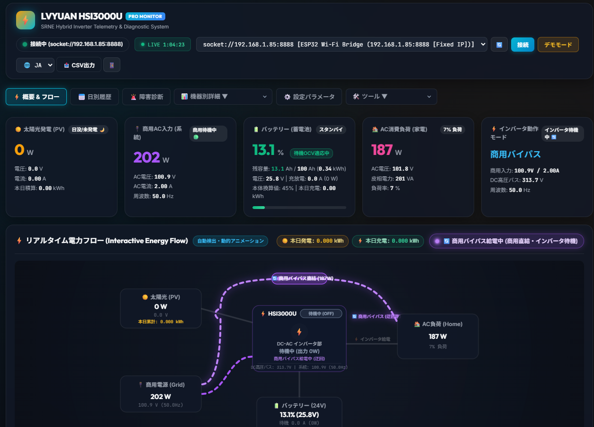
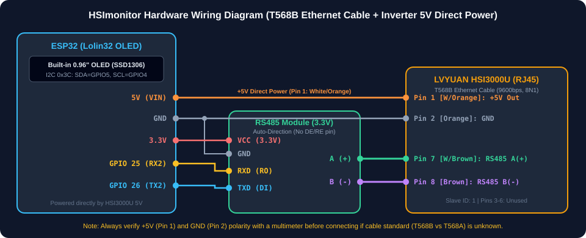

# HSImonitor (LVYUAN HSI3000U インバータ監視 ＆ ESP32 自律バッテリー救済)

[English (README.md)](README.md) | **日本語**

LVYUAN ハイブリッドインバータ **HSI3000U**（SRNE OEM 互換）向けの、**ESP32 Wi-Fi RS485 ブリッジ＋自律バッテリー救済コントローラ** と **日英対応 PC 監視 Web ダッシュボード** の統合システムです。



<!--
  TODO: 実機写真を撮影したらここに追記してください！
  
-->

---

## BOM（部品表）

| 部品 | 推奨仕様・型番 | 検索キーワード（Amazon / 秋月電子 / AliExpress 等） | 数量 |
| :--- | :--- | :--- | :---: |
| **マイコンボード** | WEMOS Lolin32 OLED（ESP32 + 0.96インチ SSD1306 I2C OLED 内蔵） | `ESP32 Lolin32 OLED 0.96 SSD1306` | 1 |
| **RS485 モジュール** | 3.3V 対応 自動送受信切替 TTL-RS485 モジュール（DE/RE ピン不要タイプ） | `TTL RS485 3.3V 自動方向制御 XY-017 XY-485` | 1 |
| **通信ケーブル** | 市販 LAN ケーブル（T568B、片側をカットして 5V・RS485 線を取り出し） | `Cat5e Cat6 LANケーブル` | 1 |
| **電源** | **不要**（インバータ RJ45 1番ピンの `+5V` 出力から直接給電） | — | 0 |

---

## 配線図とピンアサイン



| HSI3000U (RJ45) | 一般的な線色 (T568B) | ESP32 (Lolin32 OLED) | RS485 モジュール | 備考 |
| :--- | :--- | :--- | :--- | :--- |
| **1番ピン** (`+5V`) | 橙白（白/橙） | `5V` (`VIN`) | — | インバータから直接 5V 給電 |
| **2番ピン** (`GND`) | 橙 | `GND` | `GND` | 共通 GND |
| — | — | `3.3V` | `VCC` | RS485 モジュール用 3.3V 電源 |
| — | — | `GPIO 25` (`Serial2 RX`) | `RXD` / `RO` | `HSI485conv.ino` の `RS485_RX` |
| — | — | `GPIO 26` (`Serial2 TX`) | `TXD` / `DI` | `HSI485conv.ino` の `RS485_TX` |
| **7番ピン** (`RS485 A+`) | 茶白（白/茶） | — | `A (+)` | RS485 Data + |
| **8番ピン** (`RS485 B-`) | 茶 | — | `B (-)` | RS485 Data - |
| — | — | `GPIO 5` / `GPIO 4` | — | 内蔵 OLED（`SDA=5`, `SCL=4`, I2C `0x3C`） |

> **注意：** 市販ストレートケーブルの多くは T568B 結線（1番=橙白、2番=橙）ですが、T568A やクロスケーブルでは 1〜2番の線色が異なります。接続前にテスターで `+5V` と `GND` の極性を確認してください。

---

## ディレクトリ構成

```text
HSImonitor/
├── firmware/
│   └── HSI485conv/
│       └── HSI485conv.ino      # ESP32 スケッチ (透過ブリッジ + 自律救済 + OLED)
├── pc_server/
│   ├── server.py               # FastAPI + WebSocket サーバー (Port 8000)
│   ├── modbus_driver.py        # Modbus RTU (TCP/シリアル) ドライバ
│   ├── auto_rescue.py          # ESP32 HTTP 同期 + USB-RS485 直結フォールバック
│   ├── lfp_estimator.py        # LiFePO4 8S 適応型 EKF SOC 推定
│   ├── history_manager.py      # 1分・日別履歴集計
│   ├── registers.py            # レジスタ定義 & 障害事典
│   ├── static/                 # 日英多言語対応 Web UI + locales JSON
│   ├── run.bat / stop.bat      # Windows 起動・停止バッチ
│   └── requirements.txt
└── docs/
    ├── index.html              # HTML マニュアル (GitHub Pages 対応)
    ├── guide.md / guide.ja.md  # 詳細ガイド (日英)
    └── images/wiring_diagram.svg
```

---

## クイックスタート

1. `firmware/HSI485conv/HSI485conv.ino` を Arduino IDE で開き、`ssid` / `password` を設定して **WEMOS LOLIN32** へ書き込みます。
2. PC 側で `pc_server/setup_requirements.bat`（または `pip install -r pc_server/requirements.txt`）を実行します。
3. 必要に応じて `pc_server/server.py` の接続先 IP（初期値 `socket://192.168.1.85:8888`）を変更し、`pc_server/run.bat` で起動します。
4. ブラウザで `http://localhost:8000` を開きます。

詳細ガイド：[docs/guide.ja.md](docs/guide.ja.md) | [English (docs/guide.md)](docs/guide.md) | [HTML マニュアル](docs/index.html)
