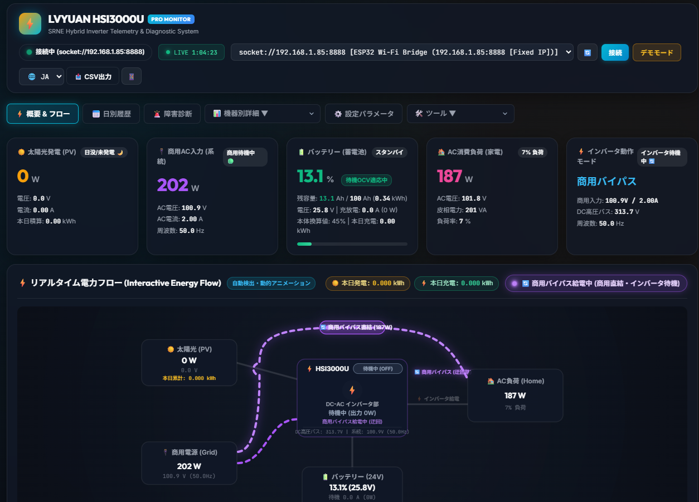
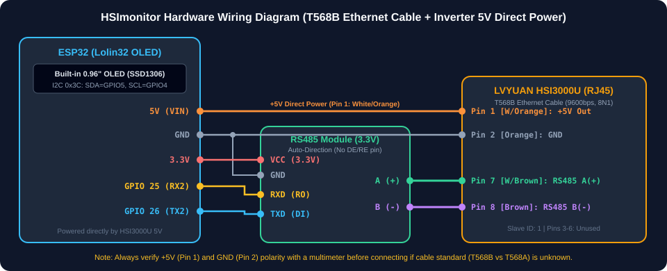

# HSImonitor (LVYUAN HSI3000U Monitor & ESP32 Autonomous Rescue)

**English** | [日本語 (README.ja.md)](README.ja.md)

A complete monitoring and autonomous battery protection system for **LVYUAN HSI3000U** (SRNE OEM-compatible) hybrid solar inverters, combining an **ESP32 (Lolin32 OLED) Wi-Fi RS485 Bridge + Autonomous Rescue Controller** with a **Bilingual (EN/JA) FastAPI Web Dashboard**.



<!--
  TODO: Add your real hardware photo here once captured!
  
-->

---

## Bill of Materials (BOM)

| Component | Recommended Spec / Model | Search Keywords (Amazon / AliExpress / Electronics Shops) | Qty |
| :--- | :--- | :--- | :---: |
| **Microcontroller** | WEMOS Lolin32 OLED (ESP32 + 0.96" SSD1306 I2C OLED) | `ESP32 Lolin32 OLED 0.96 SSD1306` | 1 |
| **RS485 Module** | 3.3V Auto-Direction TTL-to-RS485 Module (no DE/RE pin needed) | `TTL RS485 3.3V auto direction XY-017 XY-485` | 1 |
| **Inverter Cable** | Standard T568B RJ45 Ethernet Cable (cut one end; provides 5V + RS485) | `Cat5e Cat6 LAN cable` | 1 |
| **Power Supply** | *None required* — powered directly from Inverter RJ45 Pin 1 (`+5V`) | — | 0 |

---

## Wiring Diagram & Pinout



| HSI3000U (RJ45) | T568B Wire Color | ESP32 (Lolin32 OLED) | RS485 Module | Notes |
| :--- | :--- | :--- | :--- | :--- |
| **Pin 1** (`+5V Out`) | White / Orange | `5V` (`VIN`) | — | Direct 5V power from inverter |
| **Pin 2** (`GND`) | Orange | `GND` | `GND` | Common ground |
| — | — | `3.3V` | `VCC` | 3.3V logic power for RS485 module |
| — | — | `GPIO 25` (`Serial2 RX`) | `RXD` / `RO` | Defined as `RS485_RX` |
| — | — | `GPIO 26` (`Serial2 TX`) | `TXD` / `DI` | Defined as `RS485_TX` |
| **Pin 7** (`RS485 A+`) | White / Brown | — | `A (+)` | RS485 Data + |
| **Pin 8** (`RS485 B-`) | Brown | — | `B (-)` | RS485 Data - |
| — | — | `GPIO 5` / `GPIO 4` | — | Built-in OLED (`SDA=5`, `SCL=4`, I2C `0x3C`) |

> **Caution:** Straight-through T568B cables use White/Orange (Pin 1) and Orange (Pin 2). Always verify `+5V` and `GND` polarity with a multimeter before powering the ESP32, as T568A or crossover cables use different colors on Pins 1–2.

---

## Directory Structure

```text
HSImonitor/
├── firmware/
│   └── HSI485conv/
│       └── HSI485conv.ino      # ESP32 Arduino sketch (Bridge + Autonomous Rescue + OLED)
├── pc_server/
│   ├── server.py               # FastAPI + WebSocket server (Port 8000)
│   ├── modbus_driver.py        # Modbus RTU over TCP/Serial driver
│   ├── auto_rescue.py          # ESP32 HTTP sync + local RS485 fallback
│   ├── lfp_estimator.py        # Adaptive LiFePO4 8S EKF SOC estimator
│   ├── history_manager.py      # 1-min & daily telemetry aggregator
│   ├── registers.py            # HSI3000U register map & 64-code fault database
│   ├── static/                 # Bilingual (EN/JA) Web UI + locales JSON
│   ├── run.bat / stop.bat      # Windows launch & shutdown scripts
│   └── requirements.txt
└── docs/
    ├── index.html              # Visual HTML manual (GitHub Pages ready)
    ├── guide.md / guide.ja.md  # Full Markdown guides
    └── images/wiring_diagram.svg
```

---

## Key Features

1. **Autonomous Battery Rescue on ESP32 (Works Even When PC Is Offline)**
   * Monitors battery voltage directly on the ESP32 and automatically switches Setting `[06]` Charge Priority from `OSO` (Only Solar) to `CSO` (Solar First / Utility emergency charging) when voltage drops below the trigger threshold (e.g., `23.5V`).
   * Automatically reverts back to `OSO` once battery voltage recovers above the recovery threshold (e.g., `24.6V`).
   * Persists thresholds, enable/disable state, and rescue status in ESP32 non-volatile flash (NVS / `Preferences`).
2. **100% Transparent Modbus RTU Bridge (Port `8888`) + HTTP API (Port `8889`)**
   * Port `8888` remains a pure TCP ⇔ RS485 transparent bridge; when PC is connected, ESP32 passively sniffs passing frames with **zero RS485 bus collision**.
   * Port `8889` provides `GET/POST /api/rescue` for status syncing and configuration.
3. **Bilingual (EN / JA) PC Web Dashboard (Port `8000`)**
   * Real-time animated energy flow, 24-hour power charts, adaptive LiFePO4 8S SOC estimator, fault diagnostic reference, and CSV logging.

## Quick Start

1. Open `firmware/HSI485conv/HSI485conv.ino` in Arduino IDE, set your `ssid` and `password`, and flash to **WEMOS LOLIN32**.
2. On your PC, run `pc_server/setup_requirements.bat` (or `pip install -r pc_server/requirements.txt`).
3. Update the target IP in `pc_server/server.py` (default: `socket://192.168.1.85:8888`) if needed, then start with `pc_server/run.bat`.
4. Open `http://localhost:8000` in your browser.

Full documentation: [docs/guide.md](docs/guide.md) | [日本語 (docs/guide.ja.md)](docs/guide.ja.md) | [HTML Manual](docs/index.html)
